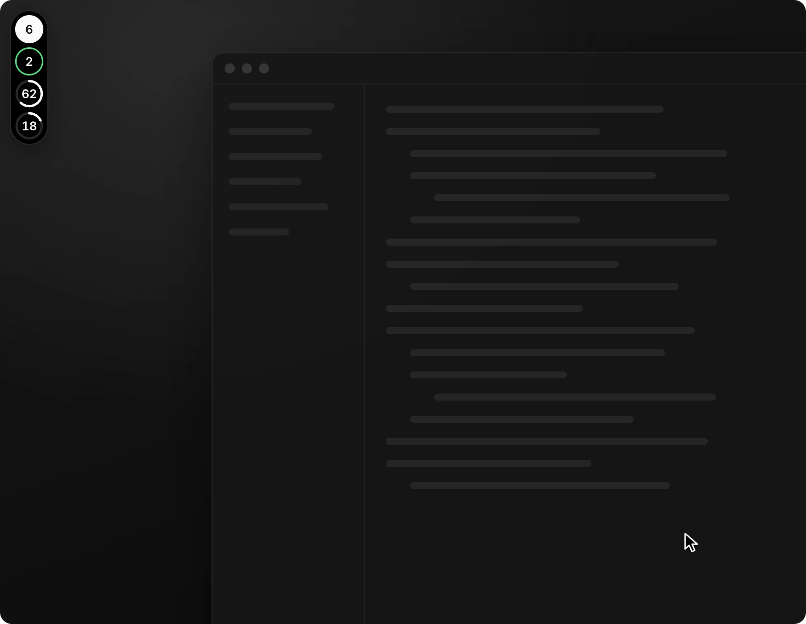
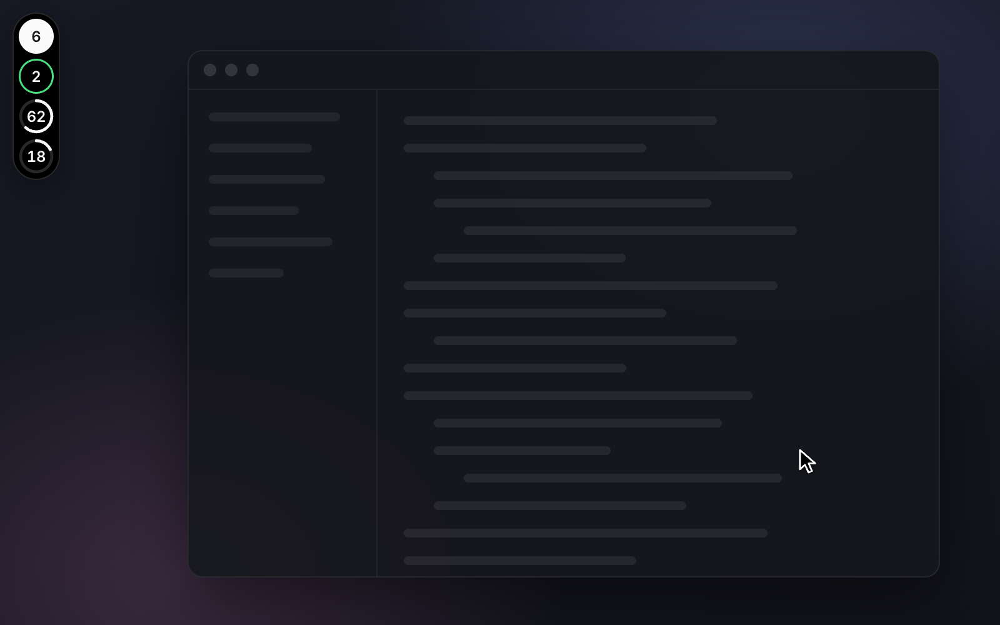
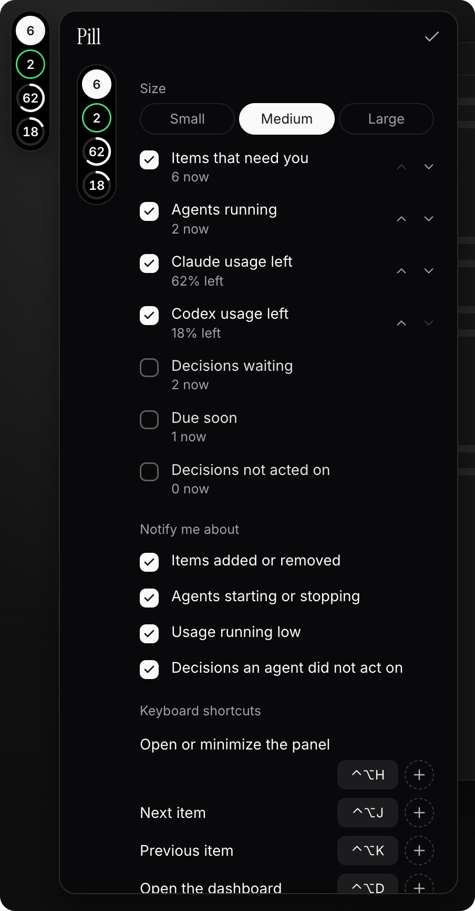
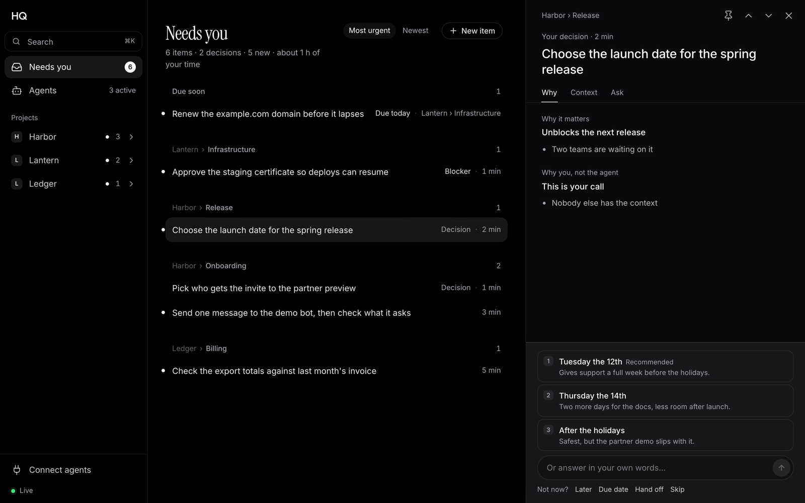

# HQ

**One inbox for everything your AI agents need from you, with a pill that floats over every app.**

## Install in one line

```sh
curl -fsSL https://raw.githubusercontent.com/dhruvyad/HQ/main/install.sh | sh
```

macOS, with Claude Code or Codex. It installs the `hq` command, then `hq setup` connects the agents you
use, puts the pill on screen and opens the dashboard. It shows each change before making it, and
`hq setup --undo` reverses it.

<p align="center"></p>

Claude Code and Codex stop to ask for a decision, a sign-in or a quick check. HQ collects every ask
in one list on your Mac, the pill counts them, and you answer in a click or with `⌃⌥H` from any app.
The agent picks up your reply, along with any screenshot or file you paste or drop in.

## What it does

### See it at a glance


Each circle is a live number: what needs you, agents running, and the Claude and Codex usage you
have left. Hover for more, such as who is running and for how long.

### Hear what changed



New asks, finished items, agents starting or stopping, usage running low. The pill opens into a
card and folds back, leaving the change beside the circle; hover it to see what changed and when.

### Track and switch accounts

 


Keep several Claude and Codex accounts, each with its usage left and when it resets. One tap
switches: every open Claude session moves to the new account, and Codex asks you to restart its
open sessions.

### Put it anywhere



Drag it to any edge or corner and it glides into place. Along the top or bottom it lies flat. It
shows over fullscreen apps too.

### Make it yours



Choose the circles, their order and the pill's size, what it tells you about, and shortcuts that
work from any app: several per action, even modifiers alone such as `⌃` with left `⌥`. Inside the
panel, the arrow keys move between items.

### Everything in one place



`hq` opens the dashboard: every item by project and workstream, what each agent is doing, and each
item's steps, links, checks and replies.

## How it works



Agents report through HQ's local tools (MCP, a CLI and lifecycle hooks), which `hq setup` installs.
A reply counts as received only once the agent acknowledges it.

Your inbox stays on your Mac: one SQLite file and a server that listens only on `127.0.0.1`. HQ
reads conversation metadata, never transcripts. Claude Desktop, the Codex desktop app and ChatGPT
have their own routes, each with its limits; see [Connections](docs/connections.md).

## Docs

- [The pill](docs/pill.md): commands, notifications, shortcuts, usage sources, the design lab
- [The dashboard](docs/dashboard.md): lists, activity, where your data lives
- [For agents](docs/for-agents.md): the CLI, readable reports, clarification threads, MCP tools
- [Connections](docs/connections.md): Codex, Claude Code, Claude Desktop and ChatGPT in depth
- [Privacy and local boundaries](docs/privacy.md)
- [Development](docs/development.md): run from a clone, tests, regenerate these pictures
- [Design guidelines](DESIGN.md)

## License

[MIT](LICENSE)
